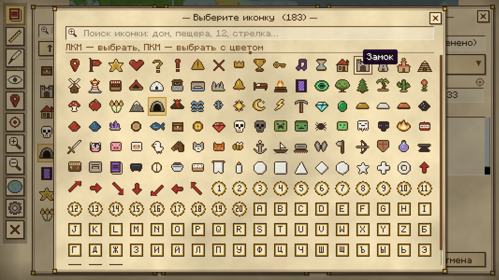
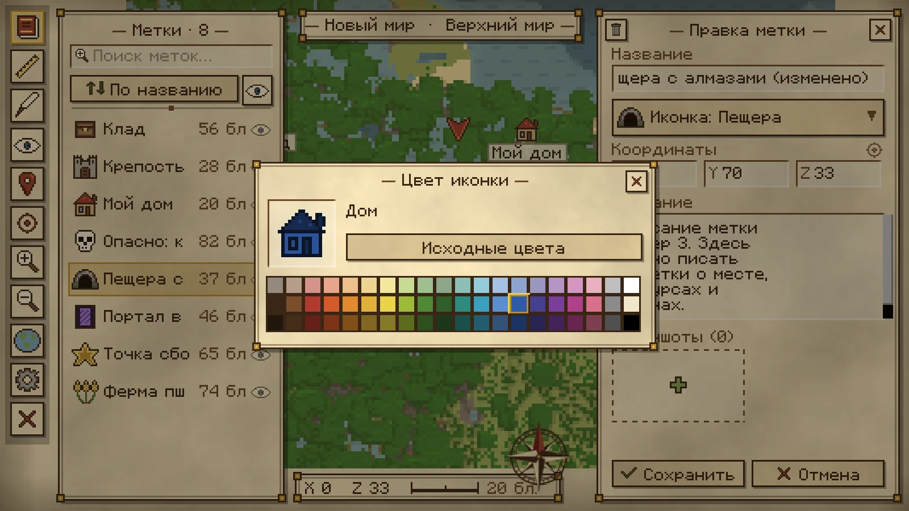
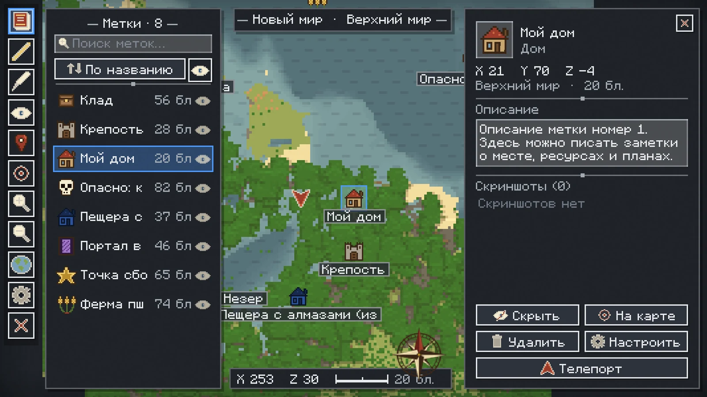
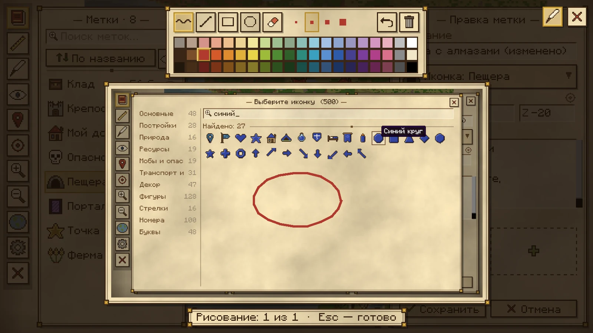
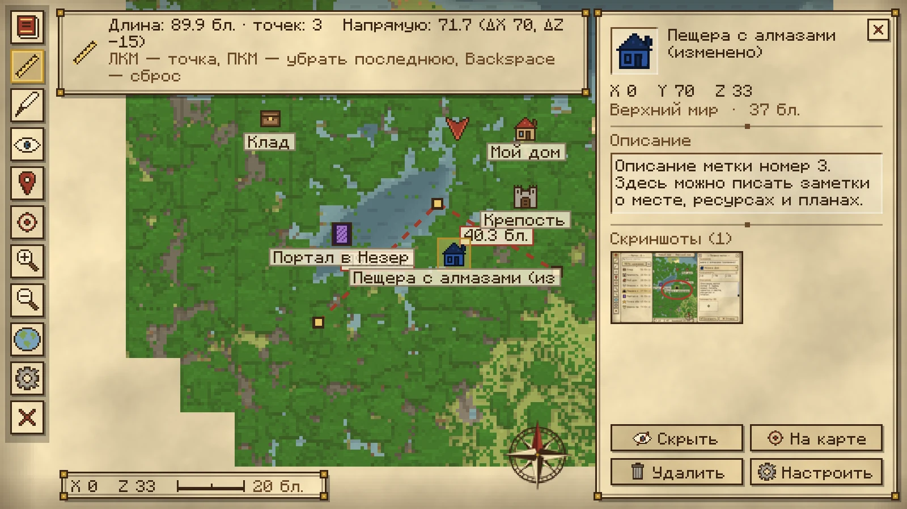

# MapMinecraft — карта мира с метками (Fabric 26.3)

Клиентский мод для **Minecraft 26.3 (Fabric)**: полноэкранная карта мира и миникарта, метки с иконками,
описаниями и скриншотами, линейка, рисование на карте, телепорт к меткам и **8 вариантов оформления**.

**Автор:** [erkinpaw](https://github.com/erkinpaw) · **Лицензия:** [MIT](LICENSE). Если используете код
или делаете форк, сохраните строку с автором.

> Мод сделан с помощью нейросети Claude (Anthropic) по идеям автора и зрителей.


## Возможности

- **Карта мира** (клавиша `M`): рисуется сама, пока вы ходите по миру. Работают масштаб, перетаскивание и переключение измерений.
- **Миникарта** (`N`, `=`/`-`): можно выбрать размер, угол экрана, масштаб и показ координат.
- **Метки**: ставятся правой кнопкой мыши по карте или клавишей `B` (метка на месте игрока). У метки есть название, координаты, описание и скриншоты.
- **Список меток** (`J`): поиск, сортировка, скрытие меток.
- **183 иконки** с поиском. Любую иконку можно **перекрасить**: правая кнопка мыши по иконке открывает палитру из 60 цветов.
- **Скриншоты в метках**: добавляются из папки скриншотов, через окно выбора файла или перетаскиванием. Поверх скриншота можно рисовать.
- **Линейка** (`R`): меряет расстояние по нескольким точкам.
- **Рисование на карте** (`G`): ручка, линия, прямоугольник, круг и ластик. Есть 60 цветов и отмена действия.
- **Телепорт к метке**: включается в настройках. Работает, если разрешены команды (читы в одиночной игре или права оператора на сервере).
- **Настройки** (кнопка-шестерёнка на карте и в главном меню). Оформление на выбор: Папирус, Камень,
  Сланец, Светлый, Тёмный, Дерево, Незер, Энд.
- **Атлас карт** в главном меню: карты, метки и скриншоты хранятся отдельно для каждого сервера и мира.
- Интерфейс на русском и английском языках.

| | |
|---|---|
|  |  |
|  |  |
|  |  |
|  |  |

## Установка

1. Установите [Fabric Loader](https://fabricmc.net/use/) для Minecraft **26.3** (loader 0.20.1 или новее).
2. Положите [Fabric API](https://modrinth.com/mod/fabric-api) (0.165.0+26.3 или новее) в папку `mods`.
3. Положите `MapMinecraft-1.2.0.jar` в ту же папку `mods`.

Мод нужен только на клиенте, ставить его на сервер не надо.

## Управление

| Клавиша | Действие |
|---|---|
| `M` | Открыть или закрыть карту |
| `J` | Список меток |
| `B` | Метка на месте игрока |
| `N` | Включить или выключить миникарту |
| `=` / `-` | Масштаб миникарты |
| `R` | Линейка (на карте) |
| `G` | Рисование (на карте) |
| `H` | Показать или скрыть рисунки |
| ПКМ по иконке | Перекрасить иконку метки |

Все клавиши можно переназначить в стандартных настройках управления Minecraft.

## Где хранятся данные

`.minecraft/mapminecraft/worlds/<id>/`: тайлы карты, метки (`markers.json`), рисунки (`drawings.json`) и
скриншоты меток. Настройки лежат в `.minecraft/config/mapminecraft.json`.

## Сборка из исходников

Нужен JDK 25 или новее.

```
./gradlew build
```

Готовый файл появится в `build/libs/`. Игровые тесты со скриншотами запускаются командой
`./gradlew runClientGameTest`, скриншоты сохраняются в `build/run/clientGameTest/screenshots/`.

---

## English

A client-side **Fabric mod for Minecraft 26.3**. It adds a world map and a minimap, markers with icons,
descriptions and screenshots, a ruler, map drawing, teleport to markers and 8 UI designs. Right-click a marker
icon to recolour it. Requires Fabric API. Author: [erkinpaw](https://github.com/erkinpaw), MIT licence
(keep the copyright notice).
