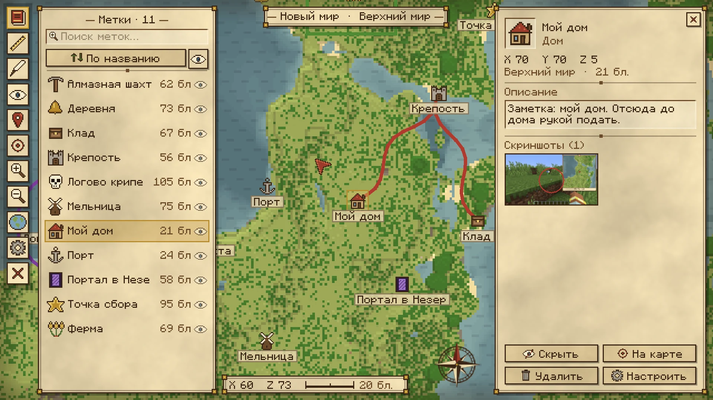
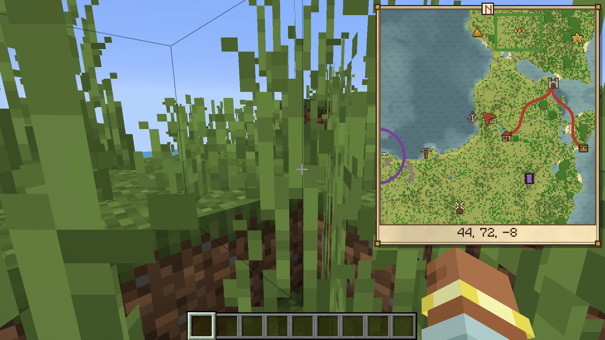
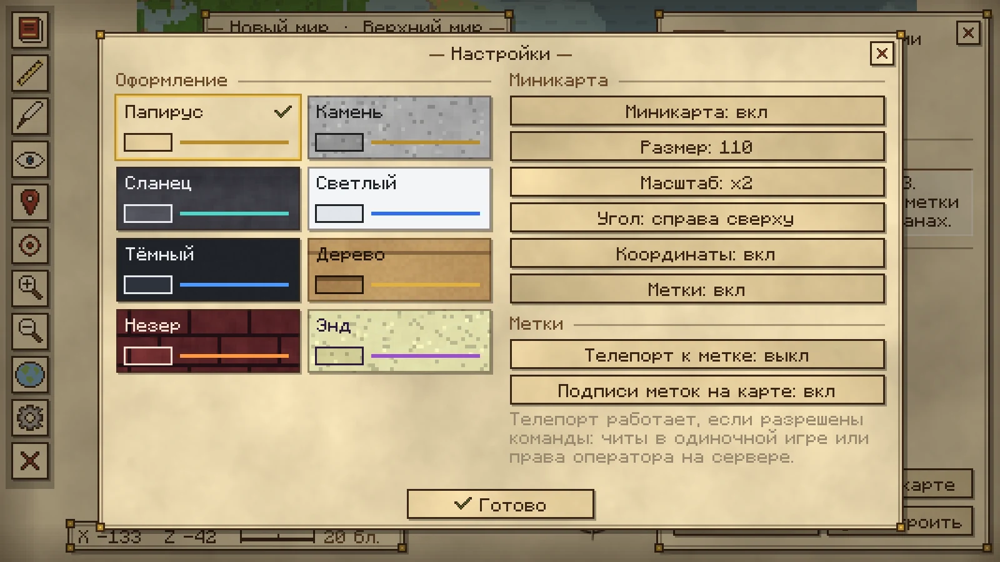
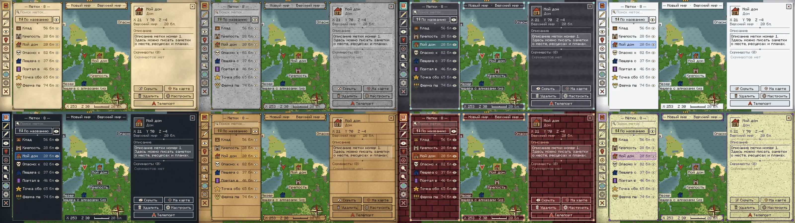

> **Language:** Русский · [English](README.en.md)

# MapMinecraft — карта мира с метками (Fabric 1.21.10)
### MapMinecraft


Клиентский мод полноэкранная карта мира и миникарта, метки с иконками, описаниями и скриншотами, линейка, рисование на карте, телепорт к меткам и **8 вариантов оформления**.

> Мод сделан с помощью ИИ по идеям автора и зрителей.

## Ветки

| Ветка | Minecraft | Java | Загрузчики |
| :---: | :---: | :---: | :---: |
| `26.3` | 26.3 | 25+ | Fabric, NeoForge |
| `26.1` | 26.1 | 25+ | Fabric, NeoForge |
| `1.21` | 1.21 | 21+ | Fabric, NeoForge |

## Галерея
| Карта мира | Миникарта |
| :---: | :---: |
|  |  |

| Настройки | Темы оформления |
| :---: | :---: |
|  |  |

## Возможности

- **Карта мира** (клавиша `M`): рисуется сама, пока вы ходите по миру. Работают масштаб, перетаскивание и переключение измерений.
- **Миникарта** (`N`, `=`/`-`): можно выбрать размер, угол экрана, масштаб и показ координат.
- **Метки**: ставятся правой кнопкой мыши по карте или клавишей `B` (метка на месте игрока). У метки есть название, координаты, описание и скриншоты.
- **Список меток** (`J`): поиск, сортировка, скрытие меток.
- **183 иконки** с поиском. Любую иконку можно **перекрасить**: правая кнопка мыши по иконке открывает палитру из 60 цветов.
- **Скриншоты в метках**: добавляются из папки скриншотов, через окно выбора файла или перетаскиванием. Поверх скриншота можно рисовать.
- **Линейка** (`R`): меряет расстояние по нескольким точкам.
- **Рисование на карте** (`G`): ручка, линия, прямоугольник, круг и ластик. Есть 60 цветов и отмена действия.
- **Телепорт к метке**: включается в настройках. Работает, если разрешены команды (читы в одиночной игре или права оператора на сервере).
- **Настройки** (кнопка-шестерёнка на карте и в главном меню). Оформление на выбор: Папирус, Камень, Сланец, Светлый, Тёмный, Дерево, Незер, Энд.
- **Атлас карт** в главном меню: карты, метки и скриншоты хранятся отдельно для каждого сервера и мира.
- Интерфейс на русском и английском языках.

## Установка

Мод работает на **Fabric** и **NeoForge**. Fabric API и другие библиотеки не требуются.

1. Установите [Fabric Loader](https://fabricmc.net/use/) (0.19.5 или новее) или [NeoForge](https://neoforged.net/) для Minecraft **1.21.10**.
2. Положите в папку `mods` один JAR под свой загрузчик:
   - `AtlasMap-Fabric-1.21.10-v1.0.jar` — для Fabric;
   - `AtlasMap-NeoForge-1.21.10-v1.0.jar` — для NeoForge.
3. Запустите игру.

Мод нужен только на клиенте, ставить его на сервер не надо.

## Управление

| Клавиша | Действие |
|---|---|
| `M` | Открыть или закрыть карту |
| `J` | Список меток |
| `B` | Метка на месте игрока |
| `N` | Включить или выключить миникарту |
| `=` / `-` | Масштаб миникарты |
| `R` | Линейка (на карте) |
| `G` | Рисование (на карте) |
| `H` | Показать или скрыть рисунки |
| ПКМ по иконке | Перекрасить иконку метки |

Все клавиши можно переназначить в стандартных настройках управления Minecraft.

## Где хранятся данные

`.minecraft/mapminecraft/worlds/<id>/`: тайлы карты, метки (`markers.json`), рисунки (`drawings.json`) и скриншоты меток. Настройки лежат в `.minecraft/config/mapminecraft.json`.

## Сборка

Нужен JDK 21 или новее.

```bash
./gradlew build
```

Команда собирает сразу два файла в `build/libs/`:

- `AtlasMap-Fabric-1.21.10-v1.0.jar`
- `AtlasMap-NeoForge-1.21.10-v1.0.jar`

Игровые тесты со скриншотами доступны в ветках `26.1` и `26.3` (в Fabric API для 1.21 нет client-gametest модуля).

## Авторы и лицензии

- **Автор мода:** [erkinpaw](https://github.com/erkinpaw/atlasmap) · **Лицензия:** [MIT](https://github.com/erkinpaw/atlasmap/blob/main/LICENSE).  
- **Автор порта на Fabric/Neoforge 1.21:** [Mr712](https://github.com/byMr712/AtlasMap-MinecraftMod) · **Лицензия:** [Apache License 2.0](LICENSE).
